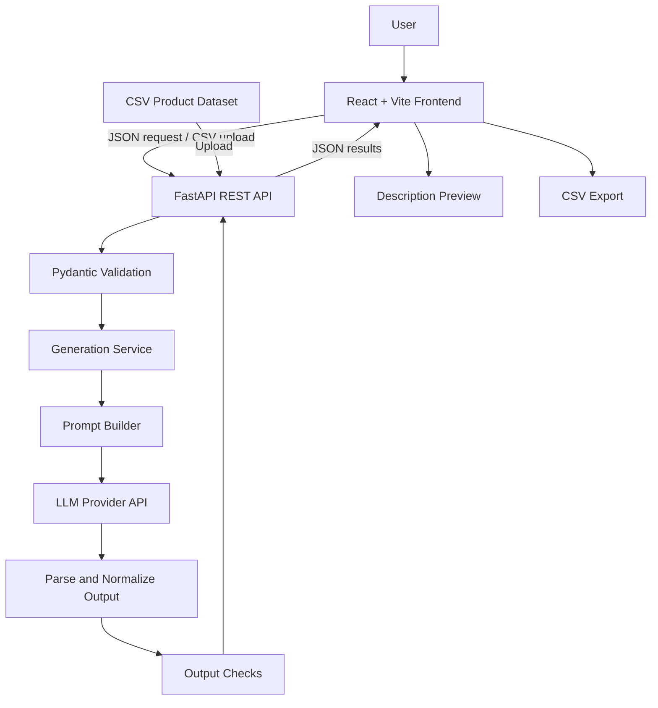
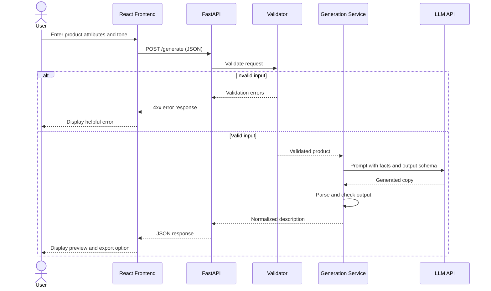
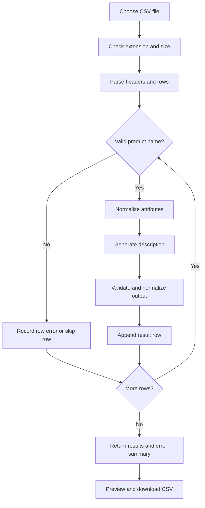

# Implementation Plan --- Retail Product Description Generator

**Project:** TCS Technology Day - Retail Product Description
Generator\
**Document type:** Technical implementation plan\
**Target:** Working prototype that can generate product copy for one
product and for a CSV catalog of 50+ products.

------------------------------------------------------------------------

## 1. Project Overview

Retailers often need to create descriptions for large product catalogs.
Manual writing is slow and can produce inconsistent tone, incomplete
details, and weak search-engine optimization (SEO).

This project will build a web application that accepts structured
product attributes and uses a Generative AI (GenAI) model to produce
clear, engaging, consistent, and SEO-friendly product descriptions.

### 1.1 Objectives

-   Generate a short and a detailed product description from structured
    product attributes.
-   Support different writing styles, such as Friendly, Professional,
    Premium, and Minimal.
-   Generate SEO keywords and a meta description.
-   Process individual products and bulk CSV uploads.
-   Validate product input and avoid unsupported product claims.
-   Export generated descriptions to CSV.
-   Evaluate output quality with documented criteria and human feedback.

### 1.2 Scope

**Included in the prototype** - Single-product generation. - CSV upload
and batch generation for at least 50 products. - Frontend form and
generated-output preview. - Configurable LLM provider through a backend
service. - Input validation, error handling, and CSV export. - Sample
dataset and setup documentation. - Basic quality evaluation.

**Not required for the first prototype** - Training a language model
from scratch. - Fine-tuning, vector databases, or a retrieval-augmented
generation (RAG) system. - User accounts, payment processing, or a
production e-commerce integration. - Computer vision or image
generation. Product image URLs/placeholders are optional metadata. - A
production database. CSV files are sufficient initially; SQLite can be
added if persistent history is needed.

------------------------------------------------------------------------

## 2. Functional Requirements

  -----------------------------------------------------------------------
  ID                      Requirement             Acceptance criteria
  ----------------------- ----------------------- -----------------------
  FR-01                   Product input           User can enter product
                                                  name, category,
                                                  features, price,
                                                  audience, tone, and
                                                  keywords.

  FR-02                   Description generation  API returns a short
                                                  description, detailed
                                                  description, SEO
                                                  keywords, and meta
                                                  description.

  FR-03                   Tone control            User can choose at
                                                  least three tones;
                                                  output follows the
                                                  selected tone.

  FR-04                   Bulk processing         User can upload a valid
                                                  CSV with 50+ products
                                                  and receive results for
                                                  valid rows.

  FR-05                   Export                  User can download
                                                  generated results as a
                                                  CSV file.

  FR-06                   Input validation        Missing product names,
                                                  invalid files,
                                                  oversized uploads, and
                                                  empty datasets produce
                                                  clear errors.

  FR-07                   Grounded output         The generation prompt
                                                  instructs the model to
                                                  use supplied facts only
                                                  and not invent
                                                  specifications.

  FR-08                   Feedback and evaluation Test results and human
                                                  ratings can be recorded
                                                  against defined quality
                                                  criteria.

  FR-09                   Documentation           README documents
                                                  installation,
                                                  configuration, API
                                                  usage, data format, and
                                                  limitations.
  -----------------------------------------------------------------------

## 3. Non-Functional Requirements

-   **Usability:** A user should be able to generate a description
    without technical knowledge.
-   **Reliability:** Backend errors should be reported clearly; a failed
    AI request should not silently be represented as a successful AI
    generation.
-   **Data quality:** Validate required columns and skip or report
    invalid rows explicitly.
-   **Security:** Keep API keys on the backend in environment variables.
    Never expose keys in frontend code or commit them to Git.
-   **Performance:** Support a demonstration batch of at least 50
    products. Record batch duration and errors.
-   **Maintainability:** Separate UI, API routes, validation, prompt
    construction, LLM integration, and export logic.
-   **Transparency:** Clearly indicate whether output came from a real
    LLM or a demo/fallback generator.
-   **Privacy:** Use public, synthetic, or appropriately licensed
    product data; do not include personal or sensitive data.

------------------------------------------------------------------------

## 4. Recommended Technology Stack

  -----------------------------------------------------------------------
  Layer                   Recommended technology  Purpose
  ----------------------- ----------------------- -----------------------
  Frontend framework      React                   Build interactive
                                                  product form, output
                                                  preview, and batch
                                                  interface.

  Frontend build tool     Vite                    Fast local development
                                                  server and production
                                                  build.

  Styling                 CSS or Tailwind CSS     Responsive layout and
                                                  visual design. Use
                                                  existing CSS if time is
                                                  limited.

  Icons                   Lucide React (optional) Consistent interface
                                                  icons.

  Backend framework       Python + FastAPI        REST API, request
                                                  validation, and
                                                  generation
                                                  orchestration.

  Data validation         Pydantic                Validate product
                                                  request fields and
                                                  response schemas.

  CSV processing          Python `csv` module;    Read input catalogs and
                          Pandas optional         create export files.

  Generative AI           Gemini API or another   Generate
                          approved LLM API        natural-language
                                                  product copy from
                                                  structured attributes.

  Configuration           `python-dotenv` and     Load API keys and
                          environment variables   runtime settings
                                                  locally.

  Testing                 `pytest` and FastAPI    Test validation,
                          `TestClient`            endpoints, and batch
                          (recommended)           behavior.

  Version control         Git and GitHub          Track changes and share
                                                  source code.

  Storage                 CSV initially; SQLite   Store sample data or
                          optional                add persistent history
                                                  if needed.
  -----------------------------------------------------------------------

### 4.1 Why this stack?

-   React provides a polished, responsive interface.
-   FastAPI is quick to implement and supports automatic API
    documentation.
-   Pydantic validates structured inputs before generation.
-   An LLM API avoids the time and compute needed to train a model from
    scratch.
-   CSV is straightforward for a short prototype and aligns with the
    problem statement's data considerations.

### 4.2 Model/provider decision

Use one LLM provider initially to keep the implementation small. The
provider should be called from the backend only. Check the provider's
current model availability, free-tier limits, pricing, and usage terms
before the demo.

If no API key is available, a clearly labelled deterministic demo
generator may be used to test the UI and batch workflow. Do not describe
fallback output as LLM-generated output.

------------------------------------------------------------------------

## 5. High-Level Architecture



### 5.1 Component responsibilities

1.  **React frontend:** Collect product attributes, tone, and keywords;
    submit requests; display errors and results; upload CSV files;
    export results.
2.  **FastAPI routes:** Expose endpoints and enforce request/file
    limits.
3.  **Validation layer:** Check required fields, types, and acceptable
    lengths.
4.  **Generation service:** Orchestrate prompt creation and model calls.
5.  **Prompt builder:** Include the product facts, selected tone, output
    requirements, and grounding rules.
6.  **LLM provider adapter:** Encapsulate the provider SDK so it can be
    replaced later.
7.  **Output parser and quality checks:** Normalize generated fields,
    enforce meta-description length where possible, check for empty
    output, and flag potential issues.
8.  **CSV service:** Read catalog rows and produce a consistent export
    schema.

------------------------------------------------------------------------

## 6. Mermaid Sequence Diagram

This sequence diagram shows the single-product workflow.



### 6.1 Bulk-processing workflow



For a short demo, process rows sequentially for simplicity. For a larger
catalog, add concurrency limits, retry logic, rate-limit handling, and
background jobs.

------------------------------------------------------------------------

## 7. Dataset Requirements and Schema

### 7.1 Recommended CSV input

Use UTF-8 CSV with one product per row. A practical schema is:

  ----------------------------------------------------------------------------------------------------
  Column                   Required?         Example                                 Notes
  ------------------------ ----------------- --------------------------------------- -----------------
  `product_id`             Recommended       `P001`                                  Stable identifier
                                                                                     for matching
                                                                                     input to output.

  `name`                   Yes               `Wireless Headphones`                   Non-empty product
                                                                                     name.

  `category`               Recommended       `Electronics`                           Helps tailor
                                                                                     language to the
                                                                                     retail domain.

  `features`               Yes for           `Bluetooth 5.3, 40-hour battery life`   Facts supplied by
                           meaningful copy                                           the retailer;
                                                                                     separate with
                                                                                     commas or use a
                                                                                     consistent
                                                                                     format.

  `specifications`         Optional          `Battery: 40 hours`                     Structured
                                                                                     technical
                                                                                     details, if
                                                                                     available.

  `price`                  Optional          `2999`                                  Store numeric
                                                                                     value when
                                                                                     possible.

  `currency`               Optional          `INR`                                   Currency code or
                                                                                     agreed display
                                                                                     format.

  `audience`               Optional          `Students and professionals`            Intended
                                                                                     audience.

  `keywords`               Optional          `wireless headphones, Bluetooth`        Preferred SEO
                                                                                     terms.

  `brand`                  Optional          `ExampleBrand`                          Use only if
                                                                                     supplied and
                                                                                     approved.

  `image_url`              Optional          `https://example.com/image.jpg`         Optional display
                                                                                     metadata;
                                                                                     validate URLs
                                                                                     before rendering.

  `existing_description`   Optional          `Current copy...`                       Useful for
                                                                                     comparison or
                                                                                     style references
                                                                                     when licensed.
  ----------------------------------------------------------------------------------------------------

For the first version, the current starter implementation uses `name`,
`category`, `features`, `audience`, `price`, `tone`, and `keywords`.
Keep the CSV headers consistent with the backend schema, or update both
together.

### 7.2 Dataset source options

1.  **Synthetic dataset:** Recommended for the time-limited prototype.
    Create 50--100 distinct products across several categories and
    clearly label them as synthetic demo data.
2.  **Public dataset:** A public retail/product dataset can be used if
    its licence permits the intended use. Record its source, licence,
    and any cleaning performed.
3.  **Existing descriptions:** Optional reference examples for style
    comparison. Do not copy proprietary content without permission.

Do not scrape retail websites without checking their terms and
permissions. Do not use personal or sensitive data.

### 7.3 Data quality checks

-   Required columns exist and the product name is non-empty.
-   Rows have unique IDs if IDs are provided.
-   Prices are non-negative numeric values when a numeric price is
    expected.
-   Category and feature fields are normalized and trimmed.
-   Empty optional fields are handled safely.
-   Duplicate rows are detected or reported.
-   Product facts are not invented to fill missing values.
-   At least 50 distinct valid products are available for the demo.
-   Keep a record of skipped rows and reasons for skips.

### 7.4 Example record

``` json
{
  "product_id": "P001",
  "name": "Wireless Headphones",
  "category": "Electronics",
  "features": [
    "Active noise cancellation",
    "40-hour battery life",
    "Bluetooth 5.3"
  ],
  "price": 2999,
  "currency": "INR",
  "audience": "Students and professionals",
  "keywords": [
    "wireless headphones",
    "noise cancellation"
  ]
}
```

------------------------------------------------------------------------

## 8. AI Prompting and Output Design

### 8.1 Prompt requirements

The prompt should:

-   Define the model's role as a retail copywriter.
-   Include only verified attributes supplied by the input.
-   Specify the chosen tone and intended audience.
-   Ask for a short description, detailed description, SEO keywords, and
    meta description.
-   Prohibit invented specifications, certifications, warranty claims,
    materials, performance claims, or guarantees.
-   Instruct the model to omit unavailable facts rather than guess.
-   Require structured JSON output where supported, or use a robust
    parser.
-   Keep the description concise, clear, useful, and appropriate for the
    product category.

### 8.2 Suggested output schema

``` json
{
  "product_id": "P001",
  "name": "Wireless Headphones",
  "short_description": "A concise factual summary.",
  "description": "A longer customer-facing product description.",
  "seo_keywords": [
    "wireless headphones",
    "noise cancellation"
  ],
  "meta_description": "A concise search-result description, ideally within 160 characters.",
  "generation_mode": "llm",
  "warnings": []
}
```

The `generation_mode` field is useful for distinguishing real LLM output
from a demo fallback. Warnings can identify missing facts or potential
claims requiring review.

### 8.3 Prompt template example

> You are a retail product copywriter. Generate clear, useful, SEO-aware
> product copy using only the supplied product facts. Do not invent or
> infer specifications, materials, certifications, warranties, or
> performance claims. If information is missing, omit it rather than
> guessing. Follow the selected brand voice. Return a short description,
> detailed description, SEO keywords, and a meta description. Keep the
> meta description within 160 characters where possible.

Inject the validated product attributes and selected tone as data. Treat
user-supplied fields as untrusted content, not as instructions that can
override the system prompt.

### 8.4 Output quality checks

-   Required output fields are present and non-empty.
-   Output refers to the correct product.
-   Numeric specifications and prices do not contradict the input.
-   No unsupported claims are apparent.
-   Meta description length is checked.
-   Keywords are relevant and not excessively repeated.
-   Tone is reasonably consistent.
-   Failed model calls are reported as failures or explicitly labelled
    fallback results.

Automated checks can catch obvious errors but cannot guarantee factual
correctness. Include human review in the demo.

------------------------------------------------------------------------

## 9. API Design

  -----------------------------------------------------------------------
  Method                  Endpoint                Purpose
  ----------------------- ----------------------- -----------------------
  `GET`                   `/`                     API welcome and
                                                  documentation pointer.

  `GET`                   `/health`               Health check and
                                                  non-secret provider
                                                  configuration status.

  `POST`                  `/generate`             Generate copy for one
                                                  product from JSON.

  `POST`                  `/generate-batch`       Upload a CSV and return
                                                  generated descriptions
                                                  for valid rows.
  -----------------------------------------------------------------------

### 9.1 Example request --- `POST /generate`

``` json
{
  "name": "Wireless Headphones",
  "category": "Electronics",
  "features": "Bluetooth 5.3, 40-hour battery life",
  "audience": "Students and professionals",
  "price": "2999 INR",
  "tone": "Friendly",
  "keywords": "wireless headphones, Bluetooth"
}
```

### 9.2 API behavior

-   Return HTTP 200 for successful generation.
-   Return an appropriate 4xx response for invalid input or CSV uploads.
-   Return a clear error for provider failures.
-   Do not return API keys or internal secrets.
-   For bulk requests, return the number of processed products and
    row-level errors when feasible.
-   Set reasonable upload and row limits.
-   Consider provider rate limits and timeouts for larger batches.

------------------------------------------------------------------------

## 10. Suggested Repository Structure

``` text
retail-product-description-generator/
├── frontend/
│   ├── src/
│   │   ├── components/
│   │   ├── pages/
│   │   ├── services/
│   │   ├── App.jsx
│   │   ├── main.jsx
│   │   └── styles.css
│   ├── package.json
│   └── index.html
├── backend/
│   ├── app/
│   │   ├── api/
│   │   │   └── routes.py
│   │   ├── schemas/
│   │   │   └── product.py
│   │   ├── services/
│   │   │   ├── generation.py
│   │   │   ├── prompt_builder.py
│   │   │   └── csv_service.py
│   │   └── main.py
│   ├── tests/
│   ├── requirements.txt
│   └── .env.example
├── data/
│   ├── sample_products.csv
│   └── README.md
├── docs/
│   └── evaluation.md
├── .gitignore
├── README.md
└── implementation.md
```

For the 2--3 hour prototype, it is acceptable to keep the backend in one
`main.py` file initially. Refactor into separate modules only if time
permits; do not delay a working end-to-end demo for folder organization.

------------------------------------------------------------------------

## 11. Implementation Phases

### Phase 1 --- Core workflow

-   Create the React form and output preview.
-   Build the FastAPI application and request schema.
-   Connect the frontend to `/generate`.
-   Test one product end to end.

**Exit criteria:** A user can submit a product and view all generated
fields.

### Phase 2 --- LLM integration

-   Configure provider credentials through backend environment
    variables.
-   Create a grounded prompt template.
-   Normalize the model response.
-   Add timeouts and clear error handling.
-   Test different product categories and writing styles.

**Exit criteria:** The application can show a real LLM response and
accurately labels any fallback mode.

### Phase 3 --- Bulk CSV

-   Validate CSV format and required columns.
-   Process at least 50 distinct product rows.
-   Handle invalid rows and empty files.
-   Export generated output to CSV.

**Exit criteria:** A 50+ product demo dataset can be processed and
downloaded.

### Phase 4 --- Quality, security, and demo

-   Test missing or malformed fields.
-   Check unsupported claims and factual consistency.
-   Add feedback collection or a small human evaluation sheet.
-   Confirm API keys are not committed to Git.
-   Prepare a short demo and setup documentation.

**Exit criteria:** The core requirements are demonstrated with
reproducible evidence.

### Suggested time allocation

  Time               Priority
  ------------------ ---------------------------------------------------
  0--20 minutes      Install dependencies and launch frontend/backend.
  20--50 minutes     Verify the single-product flow.
  50--80 minutes     Configure and test LLM generation.
  80--110 minutes    Test bulk processing and CSV export.
  110--150 minutes   Fix errors, validate data, and prepare the demo.
  Remaining time     Capture evidence and write down limitations.

------------------------------------------------------------------------

## 12. Testing and Evaluation Plan

### 12.1 Functional tests

-   Valid single-product request.
-   Missing product name.
-   Empty features.
-   Unknown or invalid tone.
-   Malformed CSV.
-   CSV with no data rows.
-   CSV with missing `name` column.
-   CSV with 50+ valid products.
-   One or more invalid rows within an otherwise valid CSV.
-   LLM timeout, quota error, or invalid model response.
-   CSV export opens correctly and preserves commas and quotation marks.

### 12.2 Quality rubric

Rate each generated description on a 1--5 scale:

  Criterion          What to evaluate
  ------------------ -----------------------------------------------
  Factual accuracy   Claims match supplied attributes.
  Relevance          Description is appropriate to the product.
  Creativity         Copy is engaging without exaggeration.
  Readability        Language is clear and well organized.
  SEO quality        Keywords are relevant and naturally included.
  Tone consistency   Output matches the selected style.

Document the number of samples reviewed, who rated them, the scoring
method, and the results. The stated 85% relevance/creativity target
should be reported only after evaluation. Any conversion from a 1--5
scale to a percentage must be explained as the project's chosen method,
not a TCS-specified formula.

### 12.3 Demo evidence

Capture: - The product input form. - A generated description in at least
two tones. - A CSV containing at least 50 products. - The batch results
and downloaded export. - A small evaluation table with actual observed
results. - Known limitations and planned improvements.

------------------------------------------------------------------------

## 13. Security, Reliability, and Limitations

-   Keep `.env` out of source control; commit `.env.example` with
    placeholder values only.
-   Call the LLM provider from FastAPI, never directly from browser
    code.
-   Do not expose stack traces, credentials, or provider secrets to the
    frontend.
-   Limit file size and number of rows.
-   Validate URLs before displaying optional product images.
-   Escape or safely render product data in the UI.
-   Add request timeouts and provider error handling.
-   For production use, add authentication, logging, rate limits,
    background jobs, persistent storage, and stronger monitoring.
-   Generated copy must be reviewed before publishing. A prompt alone
    cannot guarantee that every generated claim is correct.
-   A demo fallback is useful for development but does not count as
    proof of successful LLM integration or achievement of the quality
    target.

------------------------------------------------------------------------

## 14. Definition of Done

The prototype is ready for demonstration when:

-   [ ] Frontend and backend run locally using documented commands.
-   [ ] Single-product generation works end to end.
-   [ ] At least three writing tones are available.
-   [ ] Output includes short description, detailed description, SEO
    keywords, and meta description.
-   [ ] The app can process at least 50 distinct product records from
    CSV.
-   [ ] Generated results can be exported as CSV.
-   [ ] Invalid input and file errors are handled clearly.
-   [ ] The actual LLM mode and any fallback mode are clearly
    distinguished.
-   [ ] A sample dataset and setup instructions are included.
-   [ ] Quality checks and human feedback are documented without
    unsupported performance claims.
-   [ ] No secrets are committed to the repository.

------------------------------------------------------------------------

## 15. References

-   FastAPI documentation: https://fastapi.tiangolo.com/
-   React documentation: https://react.dev/
-   Vite documentation: https://vite.dev/
-   Pydantic documentation: https://docs.pydantic.dev/
-   Gemini API documentation and pricing:
    https://ai.google.dev/gemini-api/docs/
-   Kaggle datasets: https://www.kaggle.com/datasets

**Implementation principle:** Build the smallest reliable end-to-end
solution first. A working single-product flow, a dependable 50+ product
CSV demo, factuality checks, and honest evaluation are more valuable
than adding advanced infrastructure that cannot be demonstrated.
